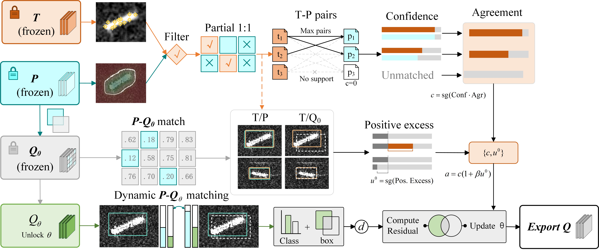
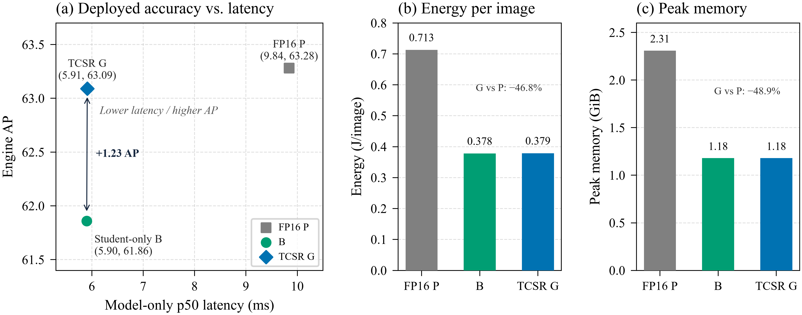

# TCSR

**TCSR: Isolating Quantization Repair from Distillation Discrepancy in
Post-Training Quantization of DETR Detectors**

Official implementation for the Knowledge-Based Systems (KBS) submission.
This repository contains the complete TCSR calibration pipeline, the full
variant table, the evaluation and paired-comparison tooling, the deployment
protocol (ONNX / TensorRT), and the paper's result tables as archived CSV
files.

> Paper link and citation entry will be added upon acceptance.



## Overview

TCSR is a post-training quantization (PTQ) method for DETR-family detectors
that repairs a quantized student detector *without* inheriting the
teacher--student discrepancy of the distillation source. The key mechanism is
**target--source isolation**:

- the **frozen full-precision student P** provides every differentiable target
  of the repair (it is the *target source*), and
- the **frozen teacher T** is only allowed to enter through detached, bounded
  corroboration coefficients (it never contributes a loss target).

Calibration runs in two stages:

1. **Stage 1 — block reconstruction** on a small calibration set;
2. **Stage 2 — set reconstruction** with Hungarian-matched set losses, where
   the TCSR coefficient rule routes each matched anchor to the student-side
   or teacher-side term.

Ten controlled variants (A, B, C, C_Q, D, E, F, G, H, I) isolate the
individual ingredients; **G is the full method**. Four settings are studied:
HRSID/RT-DETR, SSDD/RT-DETR, COCO/RT-DETR, and COCO/DefDETR (each with a
smaller student distilled from a stronger teacher).

## Headline results

AP (COCO-style, held-out split) for the representative checkpoint pairs
(`results/tab_errorchain.csv`); AP_B is the strongest distillation baseline
(variant B) and gap recovery is `(AP_G - AP_B) / (AP_P - AP_B)`:

| Setting | Pair | AP_T | AP_P | AP_Q0 | AP_B | AP_G | G - B | Gap recovery |
|---|---|---|---|---|---|---|---|---|
| HRSID/RT-DETR | HR-02 | 66.10 | 63.30 | 59.82 | 61.91 | 63.15 | +1.24 | 89.2% |
| SSDD/RT-DETR | SS-01 | 63.18 | 60.70 | 56.93 | 58.82 | 60.31 | +1.49 | 79.3% |
| COCO/RT-DETR | CR-01 | 50.12 | 46.50 | 43.52 | 45.08 | 46.16 | +1.08 | 76.1% |
| COCO/DefDETR | CD-01 | 49.06 | 45.40 | 42.30 | 44.01 | 45.02 | +1.01 | 72.7% |

- AP_T / AP_P: full-precision teacher / student reference AP.
- AP_Q0: the un-repaired quantized model (block-wise PTQ only, Stage 1).
- "mixed" bit profiles in `results/tab_main.csv` mean the decoder runs W4A8
  while the remaining supported operators run W8A8.

## Repository layout

```
tcsr/                 core library (models, quant, matching, losses,
                      calibration pipeline, evaluation, diagnostics, stats,
                      deployment helpers) -- 19 modules
tools/                command-line entry points (12):
                        calibration_manifest.py  draw calibration image list
                        calibrate.py             Stage 1 + variant table
                        evaluate.py              AP evaluation of a model list
                        method_comparison.py     paired bootstrap comparison
                        diagnostics.py           discrepancy/direction/stability
                        audit_splits.py          cross-split leakage audit
                        seeds.py                 seed namespace utilities
                        export_onnx.py           ONNX export (+ closure check)
                        build_engine.py          TensorRT engine builder
                        benchmark.py             latency/throughput/power/energy
                        operator_inventory.py    per-operator bit-width inventory
                        common.py                shared helpers
scripts/              drivers:
                        smoke.py                 end-to-end toy smoke test
                        reproduce.py             the paper's full protocol
                        make_split_manifests.py  split manifest generation
                        plot_figures.py          regenerate the paper's data figures
configs/              experiment configs (4) + bit profiles (4)
manifests/            datasets.json / checkpoints.json / seeds.json,
                      split manifests (manifests/splits/)
results/              the paper's 16 result tables as CSV
figures/              the paper's six figures (archived copies)
tests/                219 pytest tests (16 files)
outputs/              run artifacts (git-ignored)
exports/              ONNX exports and engines (git-ignored)
```

## Installation

```bash
pip install -r requirements.txt
```

Core: `torch>=2.0`, `numpy`, `scipy`, `pandas`, `matplotlib`, `tqdm`,
`pillow`. Optional (see the annotated list in `requirements.txt`):
`transformers` (HuggingFace tokenizer-free RT-DETR backbone loading),
`onnx`/`onnxruntime` (deployment), `tensorrt`/`pynvml` (engine building and
power sampling), `pytest` (tests).

The entire pipeline runs on CPU; a CUDA device only speeds up the real
calibration runs and is required for the TensorRT benchmarks.

## Data and checkpoints

**Datasets** (`manifests/datasets.json`): the manifest lists the four data
sources, split sizes, expected on-disk layout, and the calibration budgets
(512 SAR / 1024 COCO images per draw):

- HRSID — https://github.com/chaozhong2010/HRSID
- SSDD — https://github.com/TianwenZhang0825/Official-SSDD
- COCO 2017 — https://images.cocodataset.org

Expected layout (see the `expected_layout` field per dataset):

```
data_root/{dataset}/{split}/annotation.json
```

The split manifests under `manifests/splits/` record the image ids per split;
`python tools/audit_splits.py --config configs/hrsid_rtdetr.json` verifies
that all pairwise overlaps are zero (no scene/crop leakage across splits).

**Checkpoints** (`manifests/checkpoints.json`): the release archives the 12
(teacher, student) checkpoint pairs (HR-01..03, SS-01..03, CR-01..03,
CD-01..03). Download and unpack:

```
https://github.com/ZJ-Song-Lab/TCSR/releases/download/checkpoints/tcsr_checkpoints.zip
```

The archive will be attached to this repository's Releases page; record the
archive sha256 next to the download once uploaded. The upstream pretrained detectors are from
RT-DETR (https://github.com/lyuwenyu/RT-DETR) and Deformable-DETR
(https://github.com/fundamentalvision/Deformable-DETR).

**Seed convention** (`manifests/seeds.json`): every checkpoint pair has a
disjoint draw-seed namespace (e.g. HR-02: 12101-12120, 20 draws per pair).

| Seed | Value | Used by |
|---|---|---|
| draw seed | namespace value, e.g. 12101 | `tools/calibration_manifest.py` (image-list sampling) |
| optimization seed | draw seed + 500000 | `tools/calibrate.py` / `tools/evaluate.py` `--seed` |

`scripts/reproduce.py` applies the mapping automatically.

## Quickstart (no downloads)

```bash
python scripts/smoke.py
```

drives the full pipeline (calibrate -> evaluate -> method comparison ->
diagnostics) in **toy mode**: deterministic synthetic detectors replace the
real networks, so the repository exercises every stage on a CPU in about a
minute, with no checkpoints and no datasets. The toy numbers are meaningless
by construction; the run only verifies plumbing. Add `--full` to sweep the
complete variant table A..I.

## Reproducing the paper

The driver implements the repeated-calibration protocol (per checkpoint
pair: 20 draws, full variant table, paper defaults 6000 Stage-1 + 8000
Stage-2 updates, evaluation on the held-out split, paired comparison):

```bash
# full protocol for the representative HRSID pair
python scripts/reproduce.py --config configs/hrsid_rtdetr.json

# a quick real run: two draws, two variants, small update counts, on GPU
python scripts/reproduce.py --config configs/hrsid_rtdetr.json \
    --first-n 2 --variants B,G --stage1-updates 50 --stage2-updates 50 \
    --device cuda

# another checkpoint pair of the same setting (config inheritance)
python scripts/reproduce.py --config configs/hrsid_rtdetr.json --pair HR-01

# print the command sequence without running anything
python scripts/reproduce.py --config configs/hrsid_rtdetr.json --dry-run
```

Interrupted runs resume cleanly (finished seeds/variants are skipped). The
other settings are driven the same way with
`configs/ssdd_rtdetr.json`, `configs/coco_rtdetr.json`,
`configs/coco_defdetr.json`.

### Step-by-step (what the driver does)

```bash
# 1. draw the fixed calibration image list for one draw seed
python tools/calibration_manifest.py --config configs/hrsid_rtdetr.json \
    --seed 12101

# 2. calibrate: Stage 1 + the variant table (optimization seed = 12101 + 500000,
#    on the draw's fixed image list from step 1)
python tools/calibrate.py --config configs/hrsid_rtdetr.json --seed 512101 \
    --calib-manifest manifests/calibration/HR-02_12101.json

# 3. evaluate the quantized variants and the FP references
python tools/evaluate.py --config configs/hrsid_rtdetr.json \
    --seed 512101 --model fp:student \
    --model outputs/hrsid_rtdetr/HR-02/seed512101/variant_G/qmodel.pt

# 4. paired comparison over the evaluate records (contrasts G-B, G-C_Q, G-H, G-I)
python tools/method_comparison.py \
    --eval-json "outputs/hrsid_rtdetr/HR-*/seed*/variant_*/eval_test.json" \
    --eval-json "outputs/hrsid_rtdetr/HR-*/seed*/eval_test_fp_student.json" \
    --output outputs/hrsid_rtdetr/comparison.json

# 5. diagnostics (two-discrepancy gaps, direction conflict, assignment stability)
python tools/diagnostics.py --config configs/hrsid_rtdetr.json \
    --seed 512101 --variant G
```

Per-draw artifacts land in `outputs/{config}/{pair}/seed{opt}/`; see the
docstrings of each tool (`python tools/<name>.py --help`) for the full
option set, including `--device`, `--calib-manifest`, checkpoint overrides,
and `--toy` smoke modes.

## Method variants

`results/tab_ablation.csv` and `tcsr/variants.py`:

| Variant | Description |
|---|---|
| A | block reconstruction only (no Stage-2 set losses) |
| B | pure student distillation (zero teacher coefficients) — strongest baseline |
| C | count/mass-matched P-proxy (teacher-side term uses P as a proxy) |
| C_Q | as C but the proxy is the quantized student's own reconstruction |
| D | uniform coefficients on the corroborated subset |
| E | corroboration gating only (beta = 0) |
| F | priority weighting only |
| **G** | **full TCSR (corroboration gating + priority weighting)** |
| H | stratified permutation of the coefficient assignment (control) |
| I | direct teacher-valued extra term (no isolation) |

## Deployment

Frozen protocol (`tcsr/deployment.py`, `DEPLOYMENT_PROTOCOL`): 640x640 input,
batch 1, 5 sessions x (200 warm-up + 1000 timed iterations), NVML power
sampling every 100 ms, ONNX opset 21, measured on an NVIDIA L4 24 GiB with
TensorRT 10.3.0 / ONNX 1.16.1. Reported statistics: latency p50/p95,
throughput (`1000 / latency_p50_ms`), power, and energy per image
(`power_w / throughput_img_s`), with SDs over the 5 sessions.

```bash
# 1. export the calibrated (or FP) detector to ONNX and verify the closure
python tools/export_onnx.py --config configs/hrsid_rtdetr.json \
    --model fp:student \
    --model outputs/hrsid_rtdetr/HR-02/seed512101/variant_G/qmodel.pt \
    --check

# 2. build a TensorRT engine (FP16; native W4A16/W8A8 needs Q/DQ, see below)
python tools/build_engine.py --onnx exports/G.onnx --fp16

# 3. benchmark; --boundary model_only (engine execution) and/or
#    end_to_end (incl. host<->device copies + deployment decoding)
python tools/benchmark.py --backend trt --model exports/G.engine \
    --config configs/hrsid_rtdetr.json --csv results/tab_deployment.csv
```

Notes, faithfully stated:

- The exported ONNX graph carries the **exact fake-quant arithmetic** of the
  calibrated model, so an FP16 engine reproduces the framework evaluation
  (`results/tab_engineclosure.csv`, `--check` performs the ONNXRuntime
  round-trip against the source model).
- The paper's **native W4A16 / W8A8 engines** additionally require
  Q/DQ-annotated quantization of the same graph (e.g. via NVIDIA
  TensorRT ModelOptimizer / Polygraphy); `tools/build_engine.py` exposes the
  builder and provenance report, and the archived engine-closure table records
  the measured agreement.
- `tools/benchmark.py` runs both ONNXRuntime (`--backend ort`) and TensorRT
  (`--backend trt`) backends and appends rows in the `tab_deployment.csv`
  schema; every protocol parameter can be overridden on the CLI.
- `tools/operator_inventory.py` dumps the per-operator bit-width inventory of
  any exportable model (fake-quant bits per operator plus the matching
  native-engine format), with the same `--model` specifiers as
  `tools/export_onnx.py`; `--output` writes a CSV plus a provenance sidecar.



## Results

The paper's tables are archived under `results/` (one CSV per table):

| File | Content |
|---|---|
| `tab_main.csv` | main AP table per setting/method (AP, AP50, AP75, AP_S, delta vs B) |
| `tab_errorchain.csv` | error chain T -> P -> Q0 -> B/G and gap recovery |
| `tab_ablation.csv` | variant ablation with 95% CIs and Holm-corrected p-values |
| `tab_baselines.csv` | PTQ/distillation baselines per setting (mean/SD, cost) |
| `tab_bitsweep.csv` | bit-profile sweep (B/C_Q/G per profile, model size) |
| `tab_conflict.csv` | direction-conflict audit of the coefficient rule |
| `tab_cost.csv` | calibration cost (forwards/backwards/updates/time/peak memory) |
| `tab_deployment.csv` | deployment benchmark (latency/throughput/power/energy) |
| `tab_engineclosure.csv` | source-vs-engine closure and MAC mix per role |
| `tab_gapstats.csv` | two-discrepancy gap statistics (medians, IQRs, Spearman) |
| `tab_models.csv` | model inventory (backbones, reference APs, pairs, draws) |
| `tab_pairedmeans.csv` | paired means/SDs per setting and variant |
| `tab_pairrobust.csv` | pair-level robustness (B/G per checkpoint pair) |
| `tab_provenanceaudit.csv` | provenance audit (draw manifests, seed namespaces) |
| `tab_sensitivity.csv` | hyperparameter sensitivity sweep (development AP) |
| `tab_transferrobust.csv` | cross-pair transfer robustness |

`tests/test_results.py` re-derives the paper's aggregation relations
(throughput/energy identities, delta columns) directly from these files.

## Figures

The paper's six figures are archived under `figures/`:

| File | Figure |
|---|---|
| `overview.jpg` | method overview (target--source isolation, two-stage calibration) |
| `matching_strategies.jpg` | comparison of matching strategies |
| `residual_kernel_comparison.jpg` | residual kernel for unmatched queries |
| `tcsr_paired_ap_gains.png` | paired AP gains of the prespecified contrasts |
| `stratified_mechanism_evidence.png` | gap-stratified mechanism evidence (3 x 3 cells) |
| `tcsr_deployed_efficiency.png` | deployed efficiency (AP / latency / energy / memory) |

The three data figures are regenerated with `scripts/plot_figures.py`
(`--figures paired,deployed,stratified`):

```bash
# paired AP gains and deployed efficiency read the archived CSVs directly
python scripts/plot_figures.py --results-dir results --output-dir outputs/figures

# optional: 95% CIs on the paired-gain figure, from a tools/method_comparison.py
# CSV (one per setting, as produced with --csv)
python scripts/plot_figures.py --contrast-csv outputs/hrsid_rtdetr/comparison.csv

# the stratified figure reads the diagnostics JSON written by tools/diagnostics.py
python scripts/plot_figures.py --figures stratified \
    --stratified-json outputs/hrsid_rtdetr/HR-02/seed512101/diagnostics.json
```

## Tests

```bash
pytest
```

219 tests cover the quantizer arithmetic, block/set losses, matching,
variant table, calibration pipeline, evaluation, diagnostics, statistics,
deployment helpers, figure/plotting helpers, the operator inventory, and the
archived result tables. Deployment tests that
need TensorRT/NVML degrade to import/availability checks when the packages
are absent.

## License

MIT — see [LICENSE](LICENSE).

## Citation

```bibtex
@article{tcsr2026,
  title   = {TCSR: Isolating Quantization Repair from Distillation
             Discrepancy in Post-Training Quantization of DETR Detectors},
  journal = {Knowledge-Based Systems},
  year    = {2026},
  note    = {Under review}
}
```
